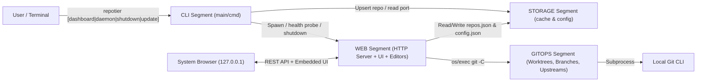

# High-Level Design: `repotier`

## Problem

Developers working across multiple local Git repositories and linked worktrees (`git worktree`) must repeatedly run terminal commands across directories to inspect worktree cleanliness, see which branch is checked out where, manage upstream tracking references, clean up merged or unmerged worktrees/branches, and open specific worktrees in local IDEs. Existing Git GUIs are heavyweight desktop applications oriented around commit graphs and staging rather than fast cross-repository worktree and branch lifecycle management.

## Approach

`repotier` is a single-binary Go CLI paired with an embedded localhost web dashboard (`127.0.0.1`).

1. **Zero-Friction CLI Entry & Auto-Discovery:** Running `repotier` inside any Git repository or linked worktree resolves the canonical main repository root (`git rev-parse --path-format=absolute --git-common-dir`), records it in a persistent file-locked cache (`~/.cache/repotier/repos.json`), ensures a background localhost daemon is running, and opens the browser pre-selected to that repository.
2. **Localhost Daemon & Embedded Single-Page UI:** The background daemon binds strictly to `127.0.0.1:<port>` (default `45910`), serves an embedded HTML/CSS/JS dashboard (`//go:embed`), and exposes a JSON REST API guarded against cross-origin requests.
3. **Direct Git CLI Execution:** All repository health checks, worktree listings, branch/upstream mutations, and deletions execute `git -C <path> ...` via `os/exec`, preserving the user's `.gitconfig`, SSH agent, and Git safety invariants.
4. **Flat Single-Package Codebase:** The binary uses a flat Go package layout and standard library `flag` + `net/http` routing rather than CLI frameworks or multi-layer internal package hierarchies, minimizing boilerplate while organizing design intent into four cohesive arrow segments (`CLI`, `STORAGE`, `GITOPS`, `WEB`).

## Target Users

- **Multi-worktree developers** who maintain parallel feature branches in linked worktrees (`git worktree add`) and need a single view to see dirty state, launch an IDE (`agy`, `vscode`, `windsurf`, `intellij`, `subl`) per worktree, and tear down worktrees + branches cleanly.
- **Multi-repository engineers** switching between local microservices or infrastructure repos who want automatic discovery without manual workspace registration.

## Goals

- Sub-second CLI startup that auto-registers the current Git repository, auto-starts the background daemon within 3 seconds if not running, and launches the dashboard.
- Full lifecycle visibility and control over worktrees (list, dirty count, open in detected/overridden editor, remove with optional `--force` and branch deletion) and local branches (upstream set/unset, ahead/behind tracking, safe `-d` deletion with `-D` escalation on `409 Conflict`).
- Single self-contained executable on macOS and Linux with zero external runtime assets or CDN dependencies.
- Self-update capability (`repotier update`) via GitHub releases with automatic daemon restart.

## Non-Goals

- **Commit history, staging, diffing, or merge conflict resolution:** `repotier` manages worktrees, local branches, upstreams, and editor launches — not file-level Git staging or log visualization.
- **Remote network Git operations:** `repotier` does not run `git fetch`, `git pull`, or `git push`; it operates strictly on local refs and cached remote tracking refs (`refs/remotes/`).
- **Non-localhost or multi-user hosting:** The HTTP server never binds to `0.0.0.0` or external interfaces.
- **Custom branch protection policies:** `repotier` does not hardcode protected branch names (`main`, `master`); it enforces only Git's native invariant (the branch checked out in the primary worktree cannot be deleted).

## Tenets

- **Git CLI is the single source of truth.** Shell out to `git` on every read rather than caching repository, worktree, or branch state in memory, trading subprocess latency for zero state drift.
- **Respect Git's native safety rails over custom policy.** Mirror `git worktree` and `git branch` refusal rules (`-d` vs. `-D`, primary worktree checkout protection) rather than inventing protected-branch lists or silently forcing operations.
- **Zero runtime dependencies beyond the binary.** Embed all frontend assets into the Go binary and rely on OS/Git primitives rather than external runtimes, databases, or CDNs.

## System Design

### Arrow Segments (`docs/intent/`)

| Segment Node | Prefix | Responsibility |
|---|---|---|
| `docs/intent/cli/` | `CLI` | Subcommand dispatch (`dashboard`, `daemon`, `shutdown`, `update`), pre-run repository discovery, daemon auto-start & health polling, PID/port lifecycle, browser launch, and self-update. |
| `docs/intent/storage/` | `STORAGE` | File-locked repository cache (`~/.cache/repotier/repos.json`) and user configuration (`~/.config/repotier/config.json`) persistence and schema validation. |
| `docs/intent/gitops/` | `GITOPS` | `git -C` command execution and porcelain parsing for repo health, worktrees (`is_main`, `dirty_count`), branches (`checked_out_in`, `is_main_wt`, ahead/behind), upstreams, and safe/force deletion rules. |
| `docs/intent/web/` | `WEB` | `127.0.0.1` HTTP server, `localhostGuard` origin middleware, REST endpoints, editor auto-detection & non-blocking process launch, and embedded single-page dashboard (`ui/index.html`). |

## Key Design Decisions

| Decision | Chosen Option | Alternatives Considered | Rationale |
|---|---|---|---|
| **Codebase & CLI Structure** | Flat single-package Go layout using stdlib `flag` and `os.Args` dispatch | Multi-package `cmd/` + 5 `internal/*` packages with `spf13/cobra` (`Spec.md` §8); Ephemeral foreground server without background daemon | `repotier` has 4 subcommands and one `--port` flag. Stdlib `flag` and a flat package layout eliminate framework boilerplate and cross-package type plumbing while preserving the daemon architecture and REST contract. |
| **Frontend Delivery** | Single embedded `ui/index.html` using Vanilla JS + CSS via `//go:embed` | External SPA build pipeline (React/Vite) or CDN-loaded frameworks | Eliminates Node/npm build steps and guarantees offline operation on `127.0.0.1`. |
| **Concurrency & Cache Coordination** | In-process `sync.Mutex` combined with OS file lock (`syscall.Flock`) on `~/.cache/repotier/repos.json` | SQLite database or daemon-only cache writes | Allows the CLI pre-run hook to upsert discovered repositories even before the daemon starts, without risking JSON corruption under concurrent CLI/daemon access. |
| **Branch & Worktree Deletion Flow** | Two-phase HTTP `409 Conflict` with `requires_force: true` when `git branch -d` fails on unmerged commits | Always running `-D`, or blocking unmerged deletes without inline retry | Preserves Git's native unmerged-commit safety check by default while allowing immediate user confirmation in the UI modal — including when worktree removal succeeded before the branch delete step. |

## Success Metrics

- **Falsification signals (broken if any occur):**
  - Daemon binds to any non-loopback interface or accepts cross-origin mutating requests (`POST`/`PUT`/`DELETE`).
  - Concurrent `repotier` CLI invocations corrupt `~/.cache/repotier/repos.json`.
  - Deleting a branch checked out in a linked worktree fails because branch deletion was attempted before `git worktree remove`.
  - UI allows attempting deletion of the branch checked out in the primary worktree (`is_main_wt == true`).
  - Launching an editor blocks the HTTP handler or leaves zombie child processes (`<defunct>`).

## References

- Project specification: `Spec.md`
- LID instructions and arrow navigation: `AGENTS.md`
